# REA CLI

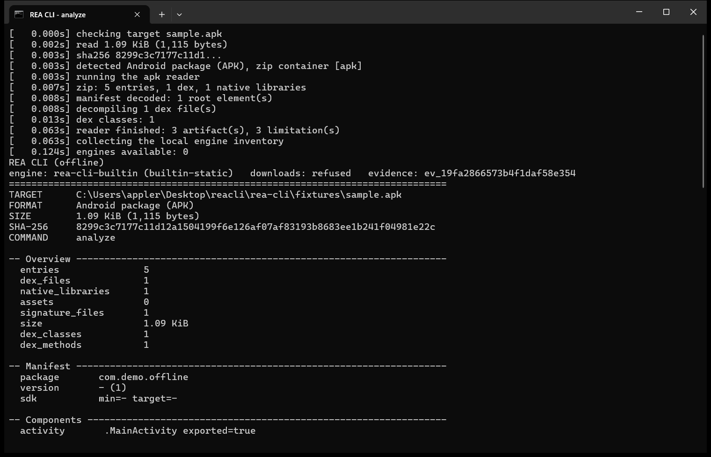

A standalone terminal workbench for reverse engineering **binaries, applications and
bytecode** on Windows. Drop a file on `rea.exe` and it identifies the format, decompiles
what the format allows, recovers source files where real code can be lifted, and records
the evidence behind every statement.

Everything runs locally. Nothing is downloaded, installed, updated or phoned home, and
remote paths are refused before any work starts.

| Readers | One-shot commands | Shell commands | Local engine probes |
| --- | --- | --- | --- |
| 29 built-in formats | 26 commands | 17 commands with aliases | 14 engines |

---

## Why it exists

| Principle | What that means in practice |
| --- | --- |
| **Evidence, not guesses** | Every result names the artifact, its SHA-256, the reader, the coverage and the limitations. Unknowns stay unknown. |
| **Offline by construction** | No network code path. Remote inputs fail with `network_refused`. |
| **One file** | A single executable; no Python, no package manager, no engine bundle required. |
| **Stays open** | A dragged file lands you in a shell; the window never closes after one operation. |
| **Shows its work** | Every stage is printed with a timestamp and saved in the report and evidence. |
| **Bounded work** | Artifact budgets, item caps and timeouts are explicit and reported. |

---

## Contents

- [Screenshots](#screenshots)
- [Quick start](#quick-start)
- [What you can do](#what-you-can-do)
- [Tool inventory](#tool-inventory)
- [Global options](#global-options)
- [Interactive shell](#interactive-shell)
- [Supported formats](#supported-formats)
- [Source recovery](#source-recovery)
- [Output layout](#output-layout)
- [Evidence](#evidence)
- [Local engines](#local-engines)
- [Recipes](#recipes)
- [Limits and honesty](#limits-and-honesty)
- [Exit codes](#exit-codes)
- [Build from source](#build-from-source)
- [Tests](#tests)
- [Project layout](#project-layout)
- [FAQ](#faq)
- [Authorization](#authorization)

---

## Screenshots

Every terminal image in this section is a real capture of the packaged `dist\rea.exe`
running in Windows Terminal. `tests\capture_screenshots.ps1` starts the console, runs the
command, waits for the run to finish, and captures the window pixels. There are no
terminal mockups; the workflow figure at the end is a diagram and is labelled as one.

### Analyze an APK: live trace, header and manifest facts


### Source recovery ends with files on disk

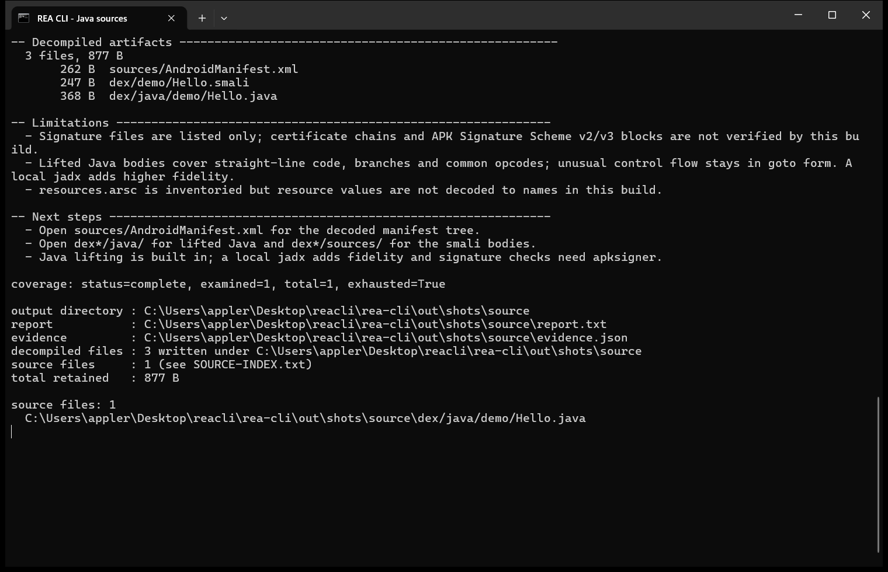

### The shell that stays open after a drag and drop

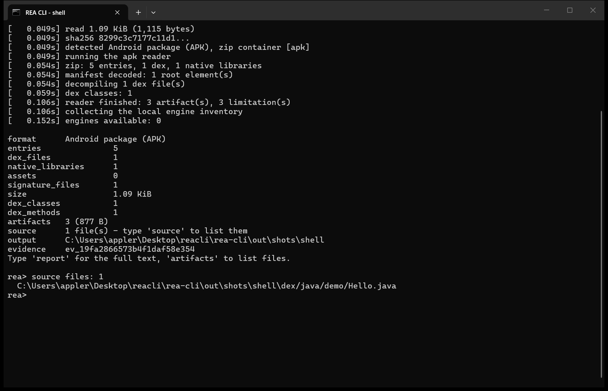

### Strings with their file offsets

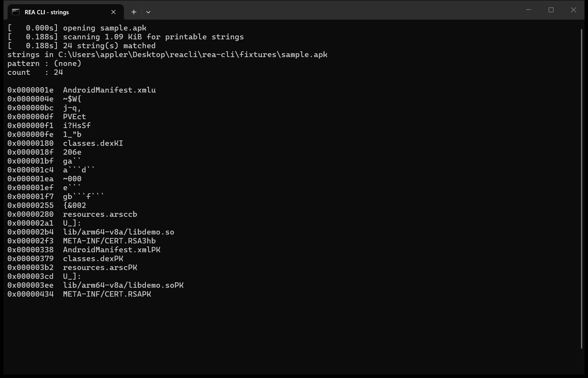

### Compare two artifacts field by field

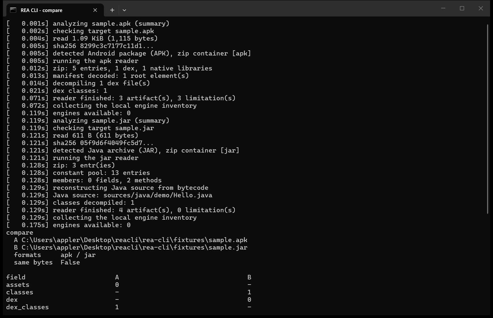

### Python bytecode turned back into source

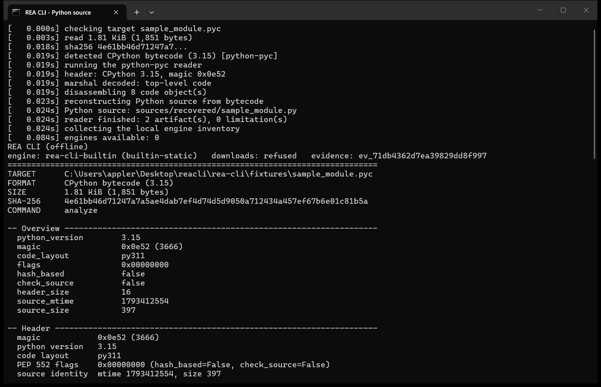

### The lifted Java file itself

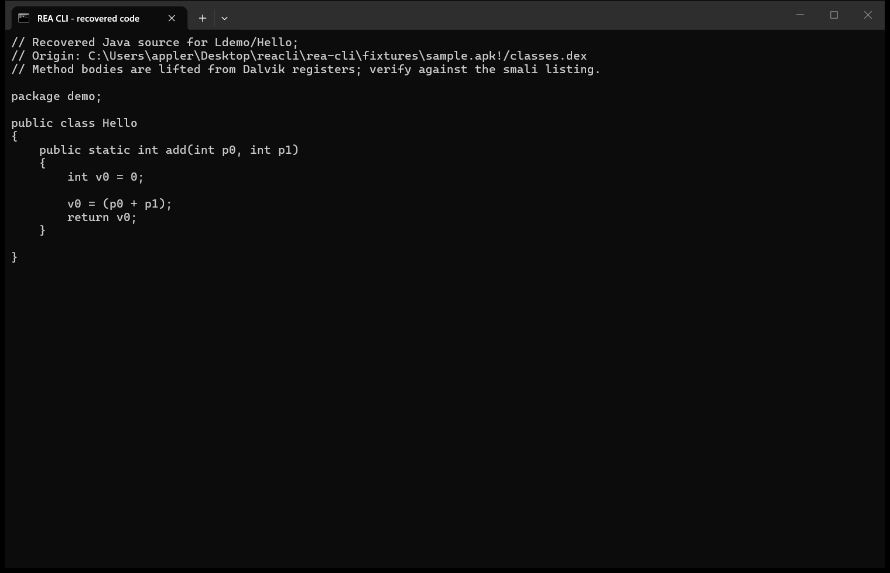

### The command surface

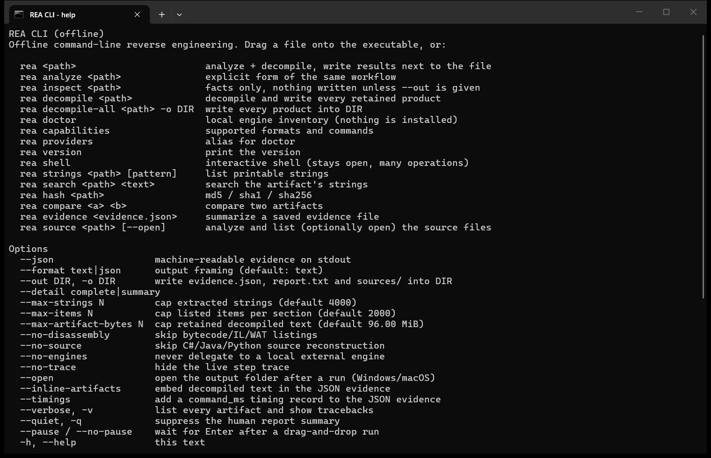

### How a run is wired (diagram)

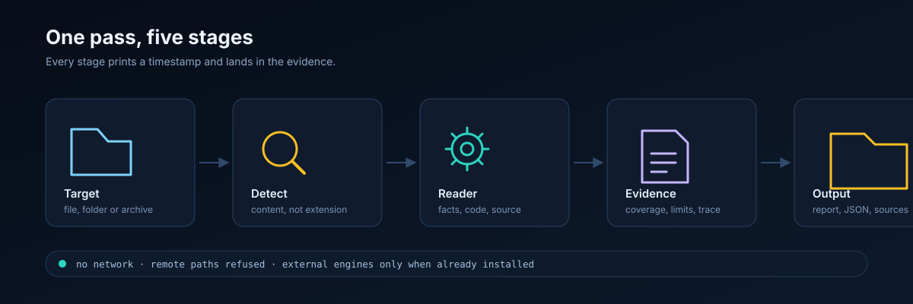

---

## Quick start

### Drag and drop

Drop any file onto `rea.exe`. The tool detects the format, analyzes and decompiles it,
writes results next to the file in `<name>.rea\`, prints the trace and report, then opens
the shell with that target loaded.

### One-shot

```powershell
rea analyze  C:\samples\app.apk --out D:\out\app
rea source   C:\samples\app.apk --out D:\out\app --open
rea strings  C:\samples\app.apk "https?"
rea hash     C:\samples\app.apk --json
rea compare  C:\builds\v1\App.dll C:\builds\v2\App.dll
```

### Shell

```powershell
rea
rea> open C:\samples\app.apk
rea> source
rea> strings https?
rea> report
rea> quit
```

> The executable is unsigned. Windows SmartScreen may warn on the first run; verify the
> file yourself, then choose "More info → Run anyway".

---

## What you can do

| Scenario | Command | Result |
| --- | --- | --- |
| Identify an unknown file | `rea inspect <path>` | Format, hashes, layout, strings, embedded signatures |
| Triage a suspicious binary | `rea analyze <path>` | Sections, imports, exports, symbols, mitigations, limitations |
| Read an Android app | `rea analyze app.apk` | Manifest tree, components, permissions, smali, lifted Java |
| Review a managed build | `rea analyze App.dll` | Metadata, references, IL, C# files |
| Compare two builds | `rea compare a.dll b.dll` | Byte identity and per-field summary differences |
| Recover source only | `rea source <path> --open` | Source files listed, folder opened |
| Audit exposed endpoints | `rea strings app.apk "https?"` | URLs with file offsets |
| Hunt a token or path | `rea search <path> <text>` | Every printable match with offsets |
| Inventory a jar or zip | `rea analyze bundle.jar` | Entries, classes, extracted text, per-class Java |
| Inspect a firmware blob | `rea analyze image.bin` | Strings, entropy, embedded container signatures |
| Read a database | `rea inspect-sqlite-database app.db` | Schema, columns, indexes, row counts, samples |
| Check a model file | `rea analyze model.gguf` | Header, tensor count, metadata key/values |
| Map an Electron app | `rea analyze resources/app.asar` | File tree, imports, URLs, Electron markers, sources |
| Keep a review bundle | `rea analyze ... --out folder` | Report, evidence, source index, all artifacts |

---

## Tool inventory

### Core workflows

| Command | Alias | Purpose |
| --- | --- | --- |
| `rea <path>` | — | Analyze + decompile + shell hand-off (interactive terminals) |
| `rea analyze <path>` | — | One-shot analysis and decompilation |
| `rea inspect <path>` | — | Facts only; nothing is written unless `--out` is given |
| `rea decompile <path>` | — | Decompile and write every retained product |
| `rea decompile-all <path>` | — | Same workflow with an explicit destination (`-o DIR`) |
| `rea source <path>` | — | Analyze, print source paths, write `SOURCE-INDEX.txt`, optional `--open` |
| `rea shell [path]` | — | Interactive terminal |

### Utility tools

| Command | Purpose |
| --- | --- |
| `rea strings <path> [pattern]` | Printable strings with offsets; pattern is a case-insensitive regex |
| `rea search <path> <text>` | Substring search over printable strings, with hit count |
| `rea hash <path>` | Size, MD5, SHA-1, SHA-256 |
| `rea compare <a> <b>` | Same-bytes check and summary-field differences |
| `rea evidence <file>` | Summarize a saved evidence document (`--json` reprints it) |
| `rea doctor` / `rea providers` | Host and local-engine inventory |
| `rea capabilities` | Built-in readers and command list |
| `rea version` | Build identifier |

### Format-specific commands

| Command | Forces reader |
| --- | --- |
| `rea inspect-python-pyc` | CPython bytecode |
| `rea inspect-java-class` | JVM class file |
| `rea inspect-dex` | Dalvik executable |
| `rea inspect-android-package` | Android APK |
| `rea inspect-managed-artifact` | .NET PE/CLI assembly |
| `rea inspect-managed-members` | .NET member listing |
| `rea inspect-wasm-artifact` | WebAssembly module |
| `rea inspect-sqlite-database` | SQLite database |
| `rea inspect-erlang-beam` | BEAM module |
| `rea analyze-javascript-application` | JavaScript, ASAR or app directory |
| `rea inspect-asar-archive` | Electron ASAR |

### Reader inventory

| Group | Formats |
| --- | --- |
| Executables | ELF, PE, Mach-O (thin and universal), .NET PE/CLI |
| Bytecode | CPython `.pyc`, JVM `.class`, Dalvik `.dex`, WebAssembly `.wasm`, Erlang BEAM |
| Mobile | APK, Android binary XML, DEX inside packages |
| Containers | zip, jar, tar, gzip, bzip2, xz, 7z, rar, ASAR |
| Applications | JavaScript files, Electron ASAR, application directories |
| Data | SQLite, GGUF, property list, JSON, Godot PCK, UnityFS |
| Fallback | text, unknown bytes (entropy, strings, embedded signatures) |

### Local engine probes

`objdump`, `llvm-objdump`, `dumpbin`, `jadx`, `javap`, `ilspycmd`, `monodis`, `wasm2wat`,
`wasm-objdump`, `rizin`, `radare2`, `upx`, `7z`, `llvm-readobj`.

---

## Global options

| Option | Effect |
| --- | --- |
| `--json` | Machine-readable evidence on stdout; progress goes to stderr |
| `--format text\|json` | Output framing |
| `--out DIR`, `-o DIR`, `--output DIR` | Destination for report, evidence, source index and artifacts |
| `--detail complete\|summary` | Summary keeps facts and drops decompiled/source products |
| `--max-strings N` | Cap extracted strings (default 4000) |
| `--max-items N` | Cap listed items and decompiled units (default 2000) |
| `--max-artifact-bytes N` | Cap retained decompiled text (default 96 MiB) |
| `--no-disassembly` | Skip bytecode / IL / WAT instruction listings |
| `--no-source` | Skip C# / Java / Python source reconstruction |
| `--no-engines` | Never call an external engine, even if installed |
| `--no-trace` | Hide the live timestamped trace |
| `--open` | Open the output folder when the run finishes (Windows) |
| `--inline-artifacts` | Embed decompiled/source text inside JSON evidence |
| `--timings` | Add a `timings.command_ms` record to JSON evidence |
| `--verbose`, `-v` | List every artifact and show tracebacks |
| `--quiet`, `-q` | Suppress the human report and summaries |
| `--pause` / `--no-pause` | Force the close prompt / disable prompt and shell hand-off |
| `-h`, `--help` / `-V`, `--version` | Help and build identifier |

---

## Interactive shell

Bare paths and `rea shell` open a prompt that stays until `quit`. Every operation keeps
the loaded target and the current output directory.

| Command | Purpose |
| --- | --- |
| `open <path>` / `o` | Load a new target and run the full workflow |
| `analyze` / `a` | Re-run the current workflow |
| `inspect` / `i` | Re-run with summary delivery (facts only) |
| `decompile` / `d` | Re-run and rewrite every artifact |
| `source [open]` / `src` | List recovered source files; open the folder |
| `strings [pattern]` / `s` | String table with offsets |
| `search <text>` / `g`, `find` | Search the target's strings |
| `hash` / `sha256`, `digest` | MD5/SHA-1/SHA-256 |
| `evidence <file>` / `ev` | Summarize a saved evidence file |
| `report` / `r` | Print the full human report |
| `artifacts` / `ls` | Every retained artifact with its absolute path |
| `compare <a> <b>` | Compare two artifacts |
| `out [dir]` | Show or change the output directory |
| `doctor`, `capabilities` | Host engines / supported formats |
| `help` / `h`, `?` | Shell help |
| `quit` / `q`, `exit` | Leave the shell |

Errors are caught and printed; a bad path never terminates the shell.

---

## Supported formats

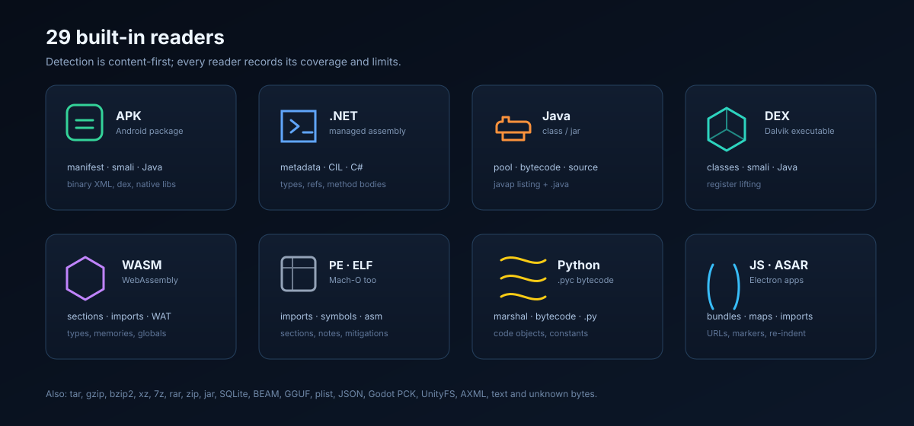

Detection is content-first: a renamed file keeps the interpretation its bytes support.

### Executables and bytecode

| Format | Analysis | Source / listings |
| --- | --- | --- |
| CPython `.pyc` | Header, PEP 552 flags, marshal code-object graph, bytecode | Recovered module plus bytecode listing |
| Java `.class` | Constant pool, flags, fields, methods, attributes, JVM bytecode | `.java` plus javap-style listing |
| `.jar`, `.zip` | Entry inventory, class decompilation, text extraction | Per-class `.java` and listing under `classes/` |
| `.dex` | Header, counts, class data, smali | Lifted Java plus smali |
| `.apk` | Binary manifest, components, permissions, dex, native libs, signatures | Manifest XML, Java, smali |
| Android binary XML | String pool, resource map, element tree | Decoded XML |
| .NET `.dll` / `.exe` | ECMA-335 metadata, heaps, signatures, references, CIL | C# files plus IL listing |
| WebAssembly | Sections, types, imports/exports, globals, memories | WAT rendering |
| ELF | Header, sections, segments, dynamic, symbols, notes | Strings plus optional disassembly |
| PE | Sections, imports, exports, resources, debug/PDB, certificates, mitigations | Strings plus optional disassembly |
| Mach-O | Header, load commands, segments, dylibs, symbols, UUID | Strings plus optional disassembly |
| Erlang BEAM | Chunks, atoms, exports, imports, code info | Module report |

### Applications, data and containers

| Format | Analysis |
| --- | --- |
| JavaScript | Imports, URLs, Electron markers, sinks, inline source maps, re-indented bundle |
| Electron ASAR | Header tree, unpacked/link entries, extracted JS/JSON, module edges |
| Application directory | Inventory, package manifest, module graph, reformatted bundles |
| tar / gzip / bzip2 / xz | Inventory; single streams are decompressed in memory and the inner artifact analyzed |
| 7z / rar | Strings plus listing through a local 7-Zip |
| SQLite | Schema, tables, columns, indexes, triggers, row counts, samples |
| GGUF | Header and metadata key/values |
| Property list | Parsed tree and XML rendering |
| JSON | Pretty-printed document |
| Godot PCK / UnityFS | Header and strings |
| Text / unknown | Stats, tokens, strings, embedded signatures, entropy, hex preview |

### Capability matrix

| Artifact produced | APK | .NET | class | jar | pyc | wasm | native | JS |
| --- | --- | --- | --- | --- | --- | --- | --- | --- |
| Facts / summary | yes | yes | yes | yes | yes | yes | yes | yes |
| Disassembly listing | smali | IL | javap | javap | bytecode | WAT | objdump | — |
| Source file | Java | C# | Java | Java | Python | — | — | JS |
| Strings with offsets | yes | yes | yes | yes | yes | yes | yes | yes |
| Manifest / metadata | XML | metadata | pool | manifest | header | sections | sections | package |

---

## Source recovery

Source files are produced where real code can be lifted. Each file starts with the
artifact path, its SHA-256 and a "best effort" note.

| Input | Language | Location | Body strategy |
| --- | --- | --- | --- |
| .NET assembly | C# | `sources/csharp/` | Metadata skeleton, properties, constants, enums, IL → statements |
| .class / .jar | Java | `sources/java/`, `classes/java/` | JVM stack machine → Java statements |
| .dex / .apk | Java | `sources/java/`, `dexN/java/` | Dalvik registers → typed locals and statements |
| .pyc | Python | `sources/recovered/` | Imports, assignments, calls, `if`, `for`, f-strings, returns |
| JS / ASAR | JavaScript | `sources/`, `sources/extracted/` | Re-indented bundle, decoded source maps |

`SOURCE-INDEX.txt` lists every source file with its absolute path. `--no-source` disables
the step; `--detail summary` keeps the facts and drops the files. When `ilspycmd` or `jadx`
is already installed, its output is added under `sources/csharp-external/` or
`sources/jadx/`; nothing is downloaded.

---

## Output layout

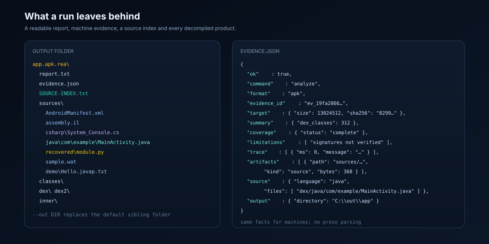

```
<name>.rea\
  report.txt            overview, sections, process, limitations, next steps
  evidence.json         machine evidence: facts, coverage, artifacts, trace
  SOURCE-INDEX.txt      every recovered source file with its absolute path
  sources\
    java\demo\Hello.java
    csharp\System_Console.cs
    recovered\module.py
    AndroidManifest.xml
    assembly.il
    sample.wat
    sample_module.pyc.dis.txt
    demo\Hello.javap.txt
    extracted\...
  classes\              jar: per-class java and javap output
  dex\ dex2\ ...        apk: smali and java per dex file
  inner\                gzip/bzip2/xz: artifacts of the inner artifact
```

`--out DIR` replaces the default sibling folder. All writes are confined to that folder;
paths containing `..` are refused.

---

## Evidence

`evidence.json` is self-contained and machine-checkable: it identifies the artifact, the
reader, the facts and the gaps.

```json
{
  "ok": true,
  "tool": { "name": "rea-cli", "label": "REA CLI (offline)" },
  "command": "analyze",
  "engine": { "name": "rea-cli-builtin", "kind": "builtin-static", "downloads": "refused" },
  "evidence_id": "ev_19fa2866573b4f1daf58e354",
  "target": { "path": "...", "size": 1115, "sha256": "...", "format_label": "...", "detected_by": "magic" },
  "format": "apk",
  "summary": { "dex_classes": 1, "entries": 5 },
  "normalized_result": { "...": "format-specific facts" },
  "coverage": { "status": "complete", "examined": 1, "total": 1, "exhausted": true },
  "limitations": ["..."],
  "observations": ["..."],
  "trace": [ { "ms": 0, "message": "detected Android package (APK)" } ],
  "artifacts": [ { "path": "dex/java/demo/Hello.java", "bytes": 368, "kind": "source" } ],
  "next_steps": ["..."],
  "output": { "directory": "...", "source_files": ["..."] }
}
```

`report.txt` renders the same content for people, including a **Process** section with
stage timings. `rea evidence <file>` summarizes a saved document later, without reopening
the original artifact.

---

## Local engines

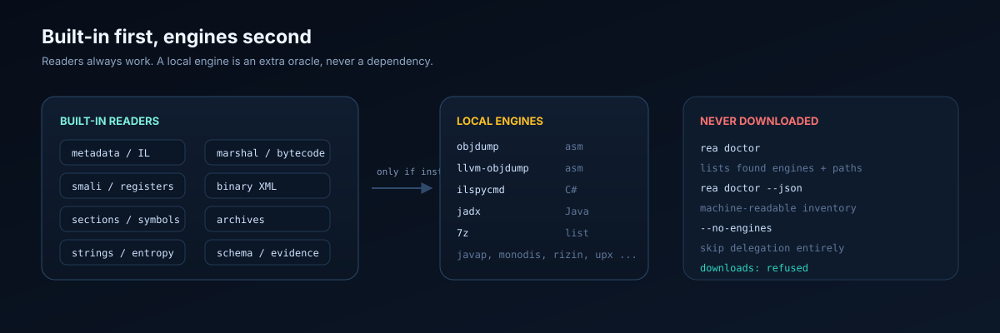

The tool never installs anything. When an engine is present it is used as an additional
oracle; otherwise the built-in reader still produces evidence.

| Engine | Used for | Output |
| --- | --- | --- |
| `objdump`, `llvm-objdump` | Native disassembly | `sources/<stem>.objdump.asm` |
| `ilspycmd` | Full C# decompilation | `sources/csharp-external/` |
| `jadx` | Full Java decompilation | `sources/jadx/` |
| `7z` / `7za` | 7-Zip and RAR listings | report section |
| Others | Detected and reported by `rea doctor`; not invoked | — |

`rea doctor` prints the exact path and version of what it found and lists what is
missing. `--no-engines` disables delegation entirely.

---

## Recipes

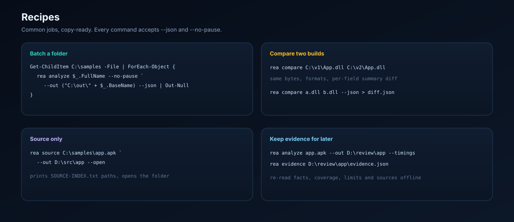

### Batch a folder

```powershell
Get-ChildItem C:\samples -File | ForEach-Object {
    .\rea.exe analyze $_.FullName --out ("C:\out\" + $_.BaseName) --no-pause --json |
        Out-Null
}
```

### Compare two builds

```powershell
.\rea.exe compare C:\builds\v1\App.dll C:\builds\v2\App.dll --json > diff.json
```

### Source only, then open the folder

```powershell
.\rea.exe source C:\samples\app.apk --out D:\src\app --open
```

### Triage URLs in a package

```powershell
.\rea.exe strings C:\samples\app.apk "https?://" --json > urls.json
```

### Keep a review bundle for later

```powershell
.\rea.exe analyze C:\samples\app.apk --out D:\review\app --timings
.\rea.exe evidence D:\review\app\evidence.json
```

### Drive the shell from a script

```powershell
@"
open C:\samples\app.apk
source
report
quit
"@ | .\rea.exe shell --out D:\review\app
```

### CI gate

```powershell
.\rea.exe analyze .\artifact.dll --json --no-pause > evidence.json
if ($LASTEXITCODE -ne 0) { throw "analysis failed" }
```

---

## Limits and honesty

- **Native pseudocode** needs Hopper, Ghidra or IDA. This build provides facts, symbols,
  strings, imports and optional `objdump` disassembly only.
- **Managed code** is rendered as C#, not recompiled; branch-heavy methods use
  `goto IL_xxxx` labels, and native methods have no IL body.
- **Java** from class files is a stack lift; `try`/`catch` blocks are not restructured.
- **DEX/APK** source is heuristic: complex register aliasing may leave comments and
  exception handlers are not reconstructed. Smali remains authoritative.
- **`.pyc`** decodes fully only when the bytecode matches the interpreter bundled in the
  executable; other releases keep header facts and say so.
- **APK** does not decode `resources.arsc` values and does not verify v2/v3 signatures.
- **7z/RAR** are only listed unless a local extractor exists.
- **Packed/obfuscated** binaries are not unpacked; the tool refuses to invent structure.
- Budgets (`--max-items`, `--max-artifact-bytes`, timeouts) are reported when hit.

Every limitation is written into the evidence and the report. Nothing is guessed.

---

## Exit codes

| Code | Meaning |
| --- | --- |
| `0` | Success |
| `1` | Recoverable failure (missing path, malformed artifact, utility failure) |
| `2` | Invalid request or usage (unknown option, bad value) |
| `70` | Internal error (reported with `--verbose`) |

Stable error codes: `invalid_request`, `unsupported_format`, `malformed_artifact`,
`limit_exceeded`, `network_refused`, `engine_unavailable`. With `--json` they print as
`{"ok": false, "error": {...}}`.

---

## Build from source

Requirements: a current Python 3 runtime, plus PyInstaller for the executable.

```powershell
python rea.py --help
powershell -ExecutionPolicy Bypass -File build\build.ps1
```

The build produces a one-file console executable with explicit hidden imports for every
reader. Rebuild after changing any `rea_core` module.

---

## Tests

```powershell
python tests\make_fixtures.py
python tests\run_smoke.py
powershell -ExecutionPolicy Bypass -File tests\exe_smoke.ps1
```

Fixtures are assembled from bytes (WASM, ELF, Mach-O, class file, DEX, AXML, ASAR, JAR,
APK, SQLite, JS app), so the suite runs without compilers or network. Current state:
0 failures across the full Python fixture set and every packaged-EXE target.

`tests\capture_screenshots.ps1` regenerates the README captures from the packaged EXE
(`-Only 01-analyze` re-shoots a single frame).

---

## Project layout

```
rea-cli\
  rea.py                     entry point
  rea_core\
    cli.py                   parsing, dispatch, delivery, shell hand-off
    shell.py                 interactive terminal
    tools.py                 strings / search / hash / compare / evidence
    progress.py              live stage trace
    detect.py                content-first detection
    context.py               analysis context and options
    report.py                evidence envelope, human report, writes
    engines.py               local engine discovery and source-engine runner
    errors.py, util.py, version.py
    formats\
      pyc.py                 CPython bytecode
      java_class.py          class-file reader, javap listing
      java_src.py            JVM bytecode -> Java
      dalvik.py              DEX reader and smali
      dex_java.py            Dalvik registers -> Java
      apk.py                 APK and binary XML manifest
      dotnet.py              ECMA-335 metadata and CIL
      csharp.py              CIL -> C#
      wasm.py                WebAssembly -> WAT
      native.py              PE / ELF / Mach-O
      jsapp.py               JavaScript, ASAR, app directories
      archive.py             archives and nested analysis
      sqlite_db.py, beam.py, blob.py
      sourcegen.py           shared emitter helpers
  assets\                    diagrams used by this README
  assets\screenshots\        real console captures used by this README
  build\                     spec and build script
  tests\                     fixtures, smoke suites and screenshot capture
  dist\rea.exe               release executable
```

---

## FAQ

**No source files were produced.**
Only code formats have source: `.dll/.exe`, `.class/.jar`, `.dex/.apk`, `.pyc`. Native
binaries, WASM and archives produce disassembly, WAT or extracted files instead. Check
`SOURCE-INDEX.txt` and the `source` line in the summary.

**A `.pyc` gave only header facts.**
The decoder uses the interpreter bundled in the executable. Bytecode from another feature
release keeps exact header facts; that limitation is recorded rather than guessed.

**The window closed anyway.**
Do not pass `--no-pause`; run `rea <path>` or `rea shell`. `--no-pause` exists for scripts
and CI and disables the hand-off.

**"results could not be written".**
The target directory is read-only (for example `C:\Windows\System32`). Pass `--out` to a
writable folder; console output still works.

**`objdump` is not found.**
Expected on a clean Windows host. Install it yourself if you want native disassembly; the
tool will not download it.

**A huge directory is slow.**
Directory analysis walks at most 20,000 files and analyzes at most 600 JavaScript files;
`--max-items` and `--max-artifact-bytes` bound the rest.

---

## Authorization

Use this tool only on artifacts you own or are authorized to inspect. It is a static
analysis workbench: it does not execute the target, does not bypass protections, does not
download anything, and writes only to the output folder you choose. Recovered source is a
reconstruction from bytecode — verify it against the retained IL, javap, smali or
disassembly evidence before relying on it.
